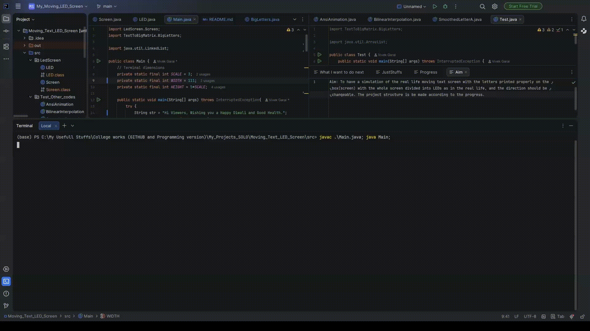
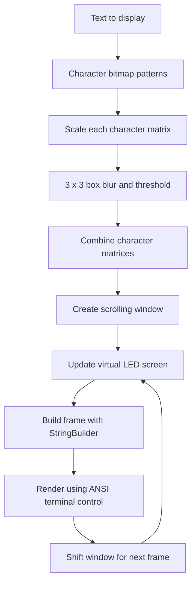

# Moving Text LED Screen

A Java-based terminal simulation of a scrolling LED dot-matrix display. The project models individual LEDs, builds characters from binary matrices, scales and smooths those character patterns, and animates the resulting text across a virtual display.

> **Project status:** Personal learning project / work in progress. The current main demonstration scrolls uppercase English letters in a terminal. It does not control a physical LED panel.

## Demo

The recordings below show the scrolling display running in the terminal. The full walkthrough includes the project code in the IDE alongside the live simulation, while the shorter clip focuses on the terminal output.

### Full simulation walkthrough — 1:23



[Watch the full simulation walkthrough (MP4)](assets/full-simulation-walkthrough.mp4)

This recording shows the Java project in the IDE and the virtual LED display rendering a custom sample message:

> HI Viewers, wishing you a Happy Diwali and Good Health.

### Focused scrolling demonstration — 0:49

[Watch the scrolling display clip (MP4)](assets/scrolling-display-clip.mp4)

This shorter recording focuses on the text moving through the virtual LED display.

The GIF above is an animated preview. The MP4 links open the complete recordings from the repository.

## The idea behind the project

The idea began with an everyday observation. One night, while visiting a bike pollution-checking and repair centre, I noticed a glowing LED display. It caught my attention, and I started wondering how such a display forms and moves text.

Around Diwali, that curiosity developed into more questions: what if the display could show different messages, patterns, or modes? How could its behaviour be represented and tested?

Building the physical hardware was not the right starting point for me because my hardware experience was limited. Instead, I decided to create a software simulation and understand the display from the inside out.

I initially expected this to be a small exercise involving matrices and object-oriented programming. It gradually introduced me to character bitmap design, matrix scaling, smoothing, display-state management, frame rendering, scrolling windows, and the principles behind LED matrix multiplexing.

This repository is both the implementation and a record of that exploration.

## What the project does

The program creates a virtual LED screen in the terminal. Each display position is represented by an LED object, and the screen is modelled as a two-dimensional array of those objects.

Text is converted into binary character patterns. The patterns are enlarged, combined into a larger matrix, and moved through a fixed-width viewing window. Each animation frame is rendered as a complete string and printed to the terminal.

### Current demonstration

The current configuration in `src/Main.java`:

- Displays the uppercase English alphabet (`A–Z`)
- Uses a virtual screen with **15 rows × 100 columns**
- Builds each character from a **5 × 5** binary bitmap
- Scales each character by a factor of **3**, producing a **15 × 15** pattern before combining it
- Inserts **two blank columns** between adjacent characters in the current matrix-combination implementation
- Moves the viewing window horizontally to create the scrolling effect
- Uses a **60 ms delay** between animation iterations

The actual frame rate depends on rendering and terminal performance, so the delay should not be interpreted as a guaranteed frame rate.

## How it works

The main rendering process can be understood as the following sequence:

1. **Define the character patterns** — each supported uppercase letter is represented by a 5 × 5 matrix containing binary values.
2. **Create scaled character matrices** — the character matrix is enlarged using nearest-neighbour-style sampling.
3. **Smooth the enlarged pattern** — a 3 × 3 box-blur neighbourhood is applied, and the resulting values are converted back to binary using a threshold.
4. **Combine the characters** — the scaled character matrices are joined row by row, with two blank columns between adjacent letters.
5. **Prepare the scrolling window** — blank columns are added before the text so that it can enter the visible area gradually.
6. **Update the display** — each row of the current window is passed to the virtual screen.
7. **Render the frame** — the screen builds a complete frame using a `StringBuilder`. ANSI escape sequences reposition the terminal cursor so the next frame can replace the previous one.
8. **Advance the window** — the first element of each row is removed and appended to the end, shifting the visible content for the next frame.

### Rendering flow



## Design and code structure

The implementation is divided into small classes so that the display, individual LEDs, and character-generation logic have separate responsibilities.

| Class | Responsibility |
|---|---|
| `LED` | Represents an individual LED and stores its two control states. It provides operations to turn the LED on or off, toggle it, and check whether it is active. |
| `Screen` | Manages the two-dimensional LED board, provides row and column operations, clears the board, and generates the terminal representation of a frame. |
| `Letters` | Stores the 5 × 5 bitmap pattern for a supported uppercase character and provides matrix-scaling and smoothing logic. |
| `BigLetters` | Converts a string into character objects, combines the scaled character matrices row by row, and provides a display helper for inspecting the combined pattern. |
| `Main` | Configures the display and text, creates the scrolling window, updates the virtual screen, and runs the animation loop. |

### Project structure

```text
Moving_Text_LED_Screen/
├── src/
│   ├── Main.java
│   ├── LedScreen/
│   │   ├── LED.java
│   │   └── Screen.java
│   ├── TextToBigMatrix/
│   │   ├── Letters.java
│   │   └── BigLetters.java
│   ├── Test_Other_codes/
│   │   ├── AnsiAnimation.java
│   │   ├── BilinearInterpolation.java
│   │   └── SmoothedLetterA.java
│   └── TextFiles/
│       ├── Aim
│       ├── Progress
│       ├── JustStuffs
│       └── What I want to do next
└── README.md
```

The `Test_Other_codes` folder contains separate experiments and explorations. These are not all part of the active execution path of the main scrolling simulation.

## Technical concepts explored

### 1. Object-oriented modelling

The display is represented through separate classes for an LED, a screen, and character patterns. This keeps the responsibilities of the main parts of the simulation distinct.

### 2. Binary bitmap fonts

Each supported character is described as a 5 × 5 matrix. A value of `1` represents an active position, while `0` represents an inactive position.

For example, the letter `A` is represented as:

```text
0 0 1 0 0
0 1 0 1 0
1 0 0 0 1
1 1 1 1 1
1 0 0 0 1
```

### 3. Matrix scaling

The current character enlargement method maps each output position back to the corresponding position in the original matrix using integer division. This is a nearest-neighbour-style upsampling approach.

### 4. Smoothing with a box blur

After enlargement, the implementation examines a 3 × 3 neighbourhood around each position, calculates the average, and applies a threshold of `0.3` to generate a binary output matrix.

This is a simple smoothing approach intended to reduce the harsh appearance of enlarged bitmap edges. It is not a full grayscale display pipeline.

### 5. Row and column state control

The `Screen` class provides row and column operations, while each LED is considered active when both of its stored control states are true. This models a basic part of the row/column addressing idea used in LED matrix displays.

### 6. Frame-based terminal animation

The animation repeatedly updates the screen, builds a frame in memory, positions the terminal cursor, and prints the frame. The scrolling effect is produced by shifting the row-wise data window between frames.

### 7. Interpolation experiments

The repository also contains a standalone bilinear interpolation experiment and a separate character-smoothing experiment. These document approaches explored during development; bilinear interpolation is **not currently used by the main scrolling pipeline**.

## Requirements

- Java Development Kit (JDK)
- A terminal that supports ANSI escape sequences
- No third-party Java libraries are required by the main simulation

The program is a terminal simulation. It does not require an LED panel, microcontroller, or other physical hardware.

## Run the simulation

Run the commands from the root of the repository.

### Windows PowerShell

```powershell
New-Item -ItemType Directory -Force out
javac -d out src/Main.java src/LedScreen/LED.java src/LedScreen/Screen.java src/TextToBigMatrix/Letters.java src/TextToBigMatrix/BigLetters.java
java -cp out Main
```

### Linux / macOS

```bash
mkdir -p out
javac -d out src/Main.java src/LedScreen/LED.java src/LedScreen/Screen.java src/TextToBigMatrix/Letters.java src/TextToBigMatrix/BigLetters.java
java -cp out Main
```

To stop the continuously running animation, interrupt the program from the terminal (usually with `Ctrl + C`).

If the display does not redraw correctly, use a terminal with ANSI escape-sequence support.

## Configuration

The current demonstration settings are defined near the beginning of `src/Main.java`:

- `SCALE` controls the character scaling factor.
- `WIDTH` controls the number of columns in the virtual screen.
- `HEIGHT` is currently calculated as five times the scaling factor.
- `str` contains the text to be displayed.
- The third argument passed to `BigLetters` is stored as a spacing field, but the current matrix-combination method inserts a fixed two-column gap.
- `Thread.sleep(60)` controls the delay between animation iterations.

The current code uses a fixed text value and fixed animation settings; it does not yet provide an interactive settings menu.

## Current limitations

The repository is an evolving simulation. The current implementation has the following limitations:

- The main character-generation logic supports uppercase English letters `A–Z` only.
- Lowercase letters, numbers, and punctuation have not yet been implemented.
- The main demonstration uses a hardcoded text string.
- Screen dimensions, character scale, and animation delay are configured in source code.
- The character enlargement and smoothing method is an initial implementation and can be improved.
- The simulation renders in a terminal; it does not communicate with or control physical LED hardware.
- Although row and column state operations are modelled, a complete timed hardware-style multiplexing scan cycle is not implemented.

## Future improvements

The following are planned directions for the project:

- Add lowercase letters, numbers, and punctuation.
- Allow text to be entered at runtime.
- Make scrolling speed configurable.
- Support selectable scrolling directions.
- Make character spacing configurable.
- Improve character enlargement and edge rendering.
- Explore multiple display patterns and operating modes.
- Develop a more complete simulation of row/column multiplexing and its timing.
- Separate the display engine from the terminal renderer so that other output methods can be explored.

These are future directions, not features claimed as complete in the current version.

## Why I built it

This project started with curiosity about a real-world LED sign. It became an opportunity to turn that observation into a software model and learn by implementing the different pieces myself.

What began as a small matrix-and-OOP exercise grew into an exploration of bitmap representation, scaling, smoothing, data structures, screen-state modelling, and animation.

The goal is not to present this as a finished hardware product, but to document the process of understanding a familiar technology by rebuilding its basic behaviour in software.

## Repository

[Moving Text LED Screen — GitHub](https://github.com/Dev-Toido/Moving_Text_LED_Screen)
